# ⚡ F.R.I.D.A.Y 2.0 — Autonomous Cyberpunk AI Super-Agent

<p align="center">
  
</p>

<p align="center">
  <a href="#-system-architecture"></a>
  <a href="#-key-super-agent-capabilities"></a>
  <a href="#-multi-model-quota-failover-router"></a>
  <a href="#-holographic-corner-widget--arc-reactor-orb"></a>
  <a href="#-speech-interruption-system"></a>
  <a href="#-complete-tool-arsenal-60-tools"></a>
  <a href="#-installation--quick-start"></a>
</p>

---

> 🚀 **F.R.I.D.A.Y** (_Friendly Reliable Intelligent Digital Assistant for Youth_) is an **Iron Man-class Autonomous Desktop & Multimodal Super-Agent** built in Python. Designed to run across **four flexible execution modes** — an interactive Cyberpunk Terminal HUD, a floating screen-corner Holographic Arc-Reactor Widget, a real-time Gemini 2.5 Live Multimodal stream, and a silent 24/7 background Windows watchdog daemon. F.R.I.D.A.Y delivers **Multimodal Live Vision & Speech**, **Multi-Model Quota Failover across 25+ Free LLMs**, **Instant Speech Interruption (&lt;30ms)**, **Autonomous Multi-Step Goal Planning with Verifications**, **Isolated Python Code Sandboxing**, **Proactive Morning Briefings**, and **ChromaDB Vector RAG Long-Term Memory**.

---

```
╔══════════════════════════════════════════════════════════════════════════════════╗
║   ███████╗██████╗ ██╗██████╗  █████╗ ██╗   ██╗                                   ║
║   ██╔════╝██╔══██╗██║██╔══██╗██╔══██╗╚██╗ ██╔╝                                   ║
║   █████╗  ██████╔╝██║██║  ██║███████║ ╚████╔╝                                    ║
║   ██╔══╝  ██╔══██╗██║██║  ██║██╔══██║  ╚██╔╝                                     ║
║   ██║     ██║  ██║██║██████╔╝██║  ██║   ██║                                      ║
║   ╚═╝     ╚═╝  ╚═╝╚═╝╚═════╝ ╚═╝  ╚═╝   ╚═╝                                      ║
║                                                                                  ║
║   ⚡ Friendly Reliable Intelligent Digital Assistant — v2.0 SUPER-AGENT HUD ⚡    ║
╚══════════════════════════════════════════════════════════════════════════════════╝
```

---

## 📑 Table of Contents

- [🚀 The 4 Launch Modes](#-the-4-launch-modes)
- [✨ Key Super-Agent Capabilities](#-key-super-agent-capabilities)
  - [👁️ 1. Multimodal Live Screen & Webcam Vision (`Live_mode.py`)](#️-1-multimodal-live-screen--webcam-vision-live_modepy)
  - [🔮 2. Holographic Corner Widget & Arc-Reactor Orb (`friday_widget.py`)](#-2-holographic-corner-widget--arc-reactor-orb-friday_widgetpy)
  - [⏹️ 3. Real-Time Speech Interruption (&lt;30ms: `Ctrl + D` / `Esc` / `q`)](#️-3-real-time-speech-interruption-30ms-ctrl--d--esc--q)
  - [🔀 4. Multi-Model Quota Failover Router (`core/llm_router.py`)](#-4-multi-model-quota-failover-router-corellm_routerpy)
  - [🎯 5. Autonomous Multi-Step Goal Planner & Verifier (`agent/`)](#-5-autonomous-multi-step-goal-planner--verifier-agent)
  - [🧠 6. Dual-Tier Memory System (Episodic & ChromaDB Vector RAG)](#-6-dual-tier-memory-system-episodic--chromadb-vector-rag)
  - [🐕 7. Proactive Background Watchdog Daemon (`services/daemon.py`)](#-7-proactive-background-watchdog-daemon-servicesdaemonpy)
  - [🤖 8. Autonomous Sub-Agents (Deep Research & Code Reviewer)](#-8-autonomous-sub-agents-deep-research--code-reviewer)
  - [🐍 9. Isolated Python Code Execution Sandbox](#-9-isolated-python-code-execution-sandbox)
  - [🛡️ 10. Triple-Tier ACL Security & Tool Guard (`core/tool_guard.py`)](#️-10-triple-tier-acl-security--tool-guard-coretool_guardpy)
  - [📱 11. Android ADB Mobile Automation Autopilot](#-11-android-adb-mobile-automation-autopilot)
- [📂 Restructured Directory Layout](#-restructured-directory-layout)
- [🏛️ System Architecture](#-system-architecture)
- [🎮 CLI Command Palette & Global Hotkeys](#-cli-command-palette--global-hotkeys)
- [🛠️ Complete Tool Arsenal (60+ Tools)](#️-complete-tool-arsenal-60-tools)
- [💻 Installation & Quick Start](#-installation--quick-start)
- [⚙️ Configuration & Key Vault](#️-configuration--key-vault)
- [📖 Interactive Web Documentation](#-interactive-web-documentation)
- [🧑‍💻 Developer & Credits](#-developer--credits)

---

## 🚀 The 4 Launch Modes

F.R.I.D.A.Y 2.0 has been re-architected into **four standalone yet interoperable execution modes**:

| Mode | Command / Shortcut | Description |
| :--- | :--- | :--- |
| 📟 **1. Cyberpunk Terminal HUD** | `python index.py` | Full-screen interactive terminal HUD powered by Rich. Voice and text modes, live status cards, instant audio interruption, and terminal command palette. |
| 🔮 **2. Holographic Corner Widget** | `python friday_widget.py`<br>*(Hotkey: `Ctrl + Space`)* | Floating screen-corner desktop assistant with an Iron Man Arc-Reactor inspired glowing neural orb, collapsibility, and glass chat panel built with `pywebview`. |
| 👁️ **3. Multimodal Live Vision** | `python Live_mode.py --mode screen`<br>`python Live_mode.py --mode camera` | Ultra-low latency bidirectional audio and visual streaming over WebSockets powered by Google's `gemini-2.5-flash-native-audio-preview` with 25+ live in-stream desktop tool executions. |
| 🐕 **4. 24/7 Silent Background Daemon** | `scripts\setup_autostart.bat` | Windows Startup daemon with silent VBS wrappers. Constantly monitors reminders, checks battery/CPU health, fires desktop toast notifications, and delivers morning voice briefings. |

---

## ✨ Key Super-Agent Capabilities

### 👁️ 1. Multimodal Live Screen & Webcam Vision (`Live_mode.py`)

F.R.I.D.A.Y features a **Real-Time Multimodal Streaming Engine** powered by Google's `gemini-2.5-flash-native-audio-preview` model over WebSockets:

- **Bidirectional Neural Audio**: Real-time natural speech conversation with ultra-low latency using Google's **Zephyr** neural voice.
- **Dynamic Visual Perception**: Streams desktop screen or real-time webcam feeds at crisp, lightweight 640x480 resolution (zero buffer lag).
- **25+ Live In-Stream Tool Calls**: During live voice/video streaming, F.R.I.D.A.Y can dynamically execute desktop actions (change volume, adjust brightness, launch applications, take screenshots, check battery, search Google) and confirm the outcome in live spoken voice without breaking the streaming session!

```bash
# Launch Live Screen Vision Mode
python Live_mode.py --mode screen

# Launch Live Webcam Vision Mode
python Live_mode.py --mode camera
```

---

### 🔮 2. Holographic Corner Widget & Arc-Reactor Orb (`friday_widget.py`)

- **Glowing Neural Arc-Reactor Orb**: Siri and Iron Man inspired pulsating particles that react dynamically to thinking, listening, and speaking states.
- **Global Summon Hotkey (`Ctrl + Space`)**: Instantly summon or dismiss the widget from anywhere on Windows, even while inside full-screen games or IDEs.
- **Collapsible Mini-Orb & Full HUD**: Switch effortlessly between a compact floating corner orb and an expansive glassmorphic HUD chat with tool status logs and markdown rendering.

```bash
# Launch Widget
python friday_widget.py

# Or run silent launcher script
scripts\run_widget.bat
```

---

### ⏹️ 3. Real-Time Speech Interruption (&lt;30ms: `Ctrl + D` / `Esc` / `q`)

Never wait for long AI responses again! When F.R.I.D.A.Y is reading out a long response, the user has full instantaneous control:

- **Instant Cutoff (&lt;30ms)**: Press **`Ctrl + D`**, **`Esc`**, or **`q`** to immediately halt PyGame audio playback.
- **Pipeline Cancellation**: Cancels further TTS audio generation in background worker threads and purges audio queues.
- **Clean Input Return**: Automatically flushes the terminal keystroke buffer and immediately returns the cursor to `👤 You: ` for the next command!

---

### 🔀 4. Multi-Model Quota Failover Router (`core/llm_router.py`)

Zero downtime from API quotas. F.R.I.D.A.Y connects to your primary configured model (OpenAI, Groq, Gemini, Ollama):

- **Automatic HTTP 429 Detection**: Catches rate limits and insufficient quota errors instantly.
- **25+ Resilient OpenRouter Free Pool**: Auto-switches across top high-tier models (`meta-llama/llama-3.3-70b-instruct:free`, `qwen/qwen3-coder:free`, `google/gemma-3-27b-it:free`, `deepseek/deepseek-r1:free`, `minimax/minimax-m2.5:free`, `nvidia/nemotron-3-super-120b:free`, etc.).
- **Cooldown Tracking**: Tracks failed models and automatically restores primary providers once quotas reset.

---

### 🎯 5. Autonomous Multi-Step Goal Planner & Verifier (`agent/`)

When given complex, multi-layered directives, F.R.I.D.A.Y doesn't guess:

- **Step Decomposition (`agent/planner.py`)**: Breaks goals into 1 to 5 structured atomic steps.
- **Step Verification Contracts**: Supports `content`, `file_exists`, `status_ok`, and `none` verification types so the executor verifies real success before proceeding.
- **Dynamic Replanning & Recovery (`agent/executor.py`)**: If an intermediate step fails, the agent self-heals, modifies parameters, or chooses an alternative tool automatically.

---

### 🧠 6. Dual-Tier Memory System (Episodic & ChromaDB Vector RAG)

F.R.I.D.A.Y remembers everything across sessions:

- **Episodic Session Memory**: Stores structured conversation summaries, extracted user preferences, and task context in `data/memory.json`.
- **Vector RAG Long-Term Memory (`ChromaDB`)**: Embeds user notes, preferences, facts, and conversation milestones using high-dimensional vector representations.
- **Proactive Memory Recall**: Surfaces relevant historical context and previous projects automatically during conversation.

---

### 🐕 7. Proactive Background Watchdog Daemon (`services/daemon.py`)

F.R.I.D.A.Y is more than a passive chatbot — she watches your system around the clock:

- **Morning Briefing Protocol**: Automatically synthesizes local weather, battery status, top news headlines, and scheduled reminders into spoken audio and **Windows Native Desktop Toast Notifications**.
- **Reminder Watchdog**: Monitors scheduled tasks and triggers real-time desktop popups when alerts fall due.
- **System Health Monitor**: Alerts on low battery (&lt;30%) and excessive CPU spikes.

---

### 🤖 8. Autonomous Sub-Agents (Deep Research & Code Reviewer)

When tasks require deep multi-step thinking, F.R.I.D.A.Y dispatches dedicated autonomous sub-agents:

| Sub-Agent | Capability |
| :--- | :--- |
| 🌐 **Deep Research Agent** | Formulates multi-angle search queries, scrapes web pages, evaluates sources, and synthesizes structured research dossiers. |
| 💻 **Code Reviewer Agent** | Scans Python/JS/C++ files, identifies syntax bugs, calculates complexity, and proposes secure, optimized refactorings. |

---

### 🐍 9. Isolated Python Code Execution Sandbox

- **Isolated Process Runner (`run_python_code`)**: Executes code in an isolated subprocess with stdout/stderr capture and a strict 15-second timeout.
- **Use Cases**: Solving complex mathematics, analyzing local CSV/JSON datasets, plotting charts, or automating file conversions.

---

### 🛡️ 10. Triple-Tier ACL Security & Tool Guard (`core/tool_guard.py`)

Enterprise-grade Access Control Lists (ACL) prevent unauthorized tool execution across different endpoints:

- **`SERVER` / `CLI` / `WIDGET` Mode**: Full access to all 60+ system tools, file system, code interpreter, and sub-agents.
- **`MOBILE` Mode**: Whitelisted for communication (WhatsApp, phone calls), tasks, reminders, web search, and weather.
- **`WEB` Mode**: Restricted to safe, read-only utilities and public search APIs.

---

### 📱 11. Android ADB Mobile Automation Autopilot

Connect your Android smartphone wirelessly or via USB:

- **`unlock_device` & `lock_device`**: Automatically sends wake and lock key events.
- **`send_whatsapp_message`**: Automates WhatsApp dispatch to any contact number.
- **`phone_call_with_mobile` & `end_phone_call`**: Triggers direct outgoing cellular calls and hangs up.
- **`youtube_with_mobile` & `google_search_with_mobile`**: Dispatches Android shell intents.

---

## 📂 Restructured Directory Layout

```
F.R.I.D.A.Y/
├── index.py                    # 📟 Primary Cyberpunk Terminal HUD Entry Point
├── friday_widget.py            # 🔮 Floating Arc-Reactor Corner HUD Widget (Ctrl + Space)
├── Live_mode.py                # 👁️ Facade for Gemini 2.5 Live Multimodal Streaming
├── requirements.txt            # 📦 Complete Python Dependencies
│
├── core/                       # 🧠 Core Cognitive Brain & Security
│   ├── brain.py                # Master-Slave execution coordinator
│   ├── llm_router.py           # Multi-model quota failover & 25+ model pool
│   ├── tool_guard.py           # Triple-tier ACL security & 60+ tool registry
│   └── context_builder.py      # Multi-tier prompt persona & live context builder
│
├── agent/                      # 🤖 Autonomous Agent Planning & Execution
│   ├── planner.py              # Goal decomposition with verification contracts
│   ├── executor.py             # Multi-step execution, dynamic retry & recovery
│   ├── sub_agents.py           # Deep Research & Code Reviewer sub-agents
│   ├── task_queue.py           # Async priority task queue
│   └── error_handler.py        # Self-healing retry policies
│
├── Live/                       # 👁️ Gemini 2.5 Live WebSocket Multimodal Stream
│   ├── live_session.py         # Bidirectional live session manager
│   ├── audio_stream.py         # PyAudio PCM streaming with interruption
│   ├── vision_stream.py        # MSS screen & OpenCV webcam streaming
│   ├── bridge.py               # Async bridge to desktop tool execution
│   └── tools_schema.py         # 25+ Gemini function calling schemas
│
├── voice/                      # 🔊 Interruptible Audio & Sensory Voice
│   ├── speak.py                # <30ms interruptible audio engine (PyGame / Edge-TTS)
│   ├── instant_filler.py       # Zero-silence immediate audio fillers
│   ├── wake_word.py            # Background "Friday" wake-word listener
│   └── voice_input.py          # SpeechRecognition with noise suppression
│
├── interface/                  # 💻 User Interfaces & HUDs
│   ├── cli_interface.py        # Rich cyberpunk terminal HUD
│   ├── index.html              # Widget holographic HUD view
│   ├── style.css               # Cyberpunk neon design system
│   ├── app.js                  # Widget frontend controller
│   └── orb.js                  # Canvas Arc-Reactor particle orb renderer
│
├── services/                   # 🐕 Background Services & Watchdogs
│   └── daemon.py               # 24/7 watchdog daemon, reminders, toast alerts
│
├── memory/                     # 💾 Dual-Tier Persistent Memory
│   ├── rag.py                  # ChromaDB vector embeddings semantic search
│   └── memory_manager.py       # Episodic conversation summaries & user profile
│
├── Tools/                      # 🛠️ 60+ Native Modular System Tools (24 modules)
│   ├── Vision.py               # Screen perception, webcam, clipboard vision
│   ├── code_interpreter.py     # Isolated Python sandbox runner
│   ├── systems_tools.py        # Volume, brightness, battery, CPU, power control
│   ├── window_manager.py       # Window focus, list running apps, state control
│   ├── media_player_tool.py    # Hardware virtual media keys
│   ├── timer_tool.py           # Multi-timer management with alarms
│   ├── document_reader.py      # PDF, DOCX, and TXT document extractor
│   ├── network_tool.py         # Network health, ping, and DNS diagnostics
│   ├── clipboard_tool.py       # Clipboard read and write automation
│   ├── Mobile_Automation.py    # Android ADB wireless & USB automation
│   ├── Emails.py               # IMAP / SMTP email checking and sending
│   ├── Todo.py                 # Persistent task to-do list manager
│   ├── reminder.py             # Natural language scheduled reminders
│   ├── File_manger.py          # Local file creation, search, edit, deletion
│   ├── browser.py              # Google search & URL summarization
│   ├── browser_autopilot.py    # Dynamic web scraping & article extraction
│   ├── weather.py              # Live meteorological forecasts
│   ├── News.py                 # Top trending news headlines
│   ├── wikipedia.py            # Wikipedia knowledge retrieval
│   ├── Date_Time.py            # Live date and time utilities
│   ├── pywhatkit.py            # YouTube playback and controls
│   └── website_opner.py        # Browser URL launcher
│
├── config/                     # ⚙️ Configuration & Key Vault
│   ├── config_driver.py        # Interactive setup wizard & key encryption
│   └── settings.py             # User preferences & toggles
│
├── scripts/                    # 🚀 Launchers, Autostart & Automation
│   ├── run_friday.bat          # Terminal HUD batch launcher
│   ├── run_widget.bat          # Floating widget batch launcher
│   ├── setup_autostart.bat     # Windows startup installer
│   ├── uninstall_autostart.bat # Windows startup uninstaller
│   └── silent VBS scripts      # Background execution wrappers
│
└── documentation/              # 📖 Interactive Web Documentation Portal
    ├── index.html              # Complete documentation website
    ├── style.css               # Futuristic responsive theme (Light/Dark)
    └── script.js               # Search engine, category filters & simulator
```

---

## 🏛️ System Architecture

The following diagram illustrates F.R.I.D.A.Y's modular architecture:

```mermaid
flowchart TB
    %% Styling Classes
    classDef inputLayer fill:#0f172a,stroke:#00f2fe,stroke-width:2px,color:#fff;
    classDef coreLayer fill:#1e1b4b,stroke:#a855f7,stroke-width:2px,color:#fff;
    classDef brainLayer fill:#172554,stroke:#3b82f6,stroke-width:2px,color:#fff;
    classDef toolLayer fill:#064e3b,stroke:#10b981,stroke-width:2px,color:#fff;
    classDef memoryLayer fill:#451a03,stroke:#f59e0b,stroke-width:2px,color:#fff;
    classDef outputLayer fill:#4c0519,stroke:#f43f5e,stroke-width:2px,color:#fff;

    %% Subgraph: Inputs & Sensory
    subgraph SENSORY_INPUTS["🌐 SENSORY INPUT & CONTROL LAYER"]
        U_KEY["⌨️ Keyboard Input (Terminal HUD)"]:::inputLayer
        U_HOT["🔮 Global Hotkey (Ctrl + Space)"]:::inputLayer
        U_MIC["🎙️ Microphone PCM Audio (16kHz)"]:::inputLayer
        U_CAM["📷 Webcam / Screen Stream (640x480)"]:::inputLayer
        U_WAKE["⚡ Wake-Word Listener ('Friday')"]:::inputLayer
        U_INT["⏹️ Real-Time Interruption (Ctrl+D / Esc)"]:::inputLayer
    end

    %% Subgraph: Main Loop Orchestration
    subgraph ORCHESTRATION["⚡ RUNTIME ORCHESTRATION ENGINES"]
        CLI["🖥️ FridayCLI Controller (interface/cli_interface.py)"]:::coreLayer
        WIDGET["🔮 Holographic Arc-Reactor Widget (friday_widget.py)"]:::coreLayer
        LIVE["👁️ Multimodal Live Engine (Live/live_session.py)"]:::coreLayer
        DAEMON["🐕 Watchdog Daemon (services/daemon.py)"]:::coreLayer
        SPEAK["🔊 Interruptible Audio Engine (voice/speak.py)"]:::coreLayer
    end

    %% Subgraph: Cognitive Brain & Reasoning
    subgraph BRAIN["🧠 COGNITIVE BRAIN & LLM REASONING"]
        BRAIN_CORE["🧠 Brain Coordinator (core/brain.py)"]:::brainLayer
        PLANNER["🎯 Autonomous Goal Planner (agent/planner.py)"]:::brainLayer
        EXECUTOR["⚡ Autonomous Executor (agent/executor.py)"]:::brainLayer
        ROUTER["🔀 Multi-Model Quota Failover (core/llm_router.py)"]:::brainLayer
        OPENROUTER_POOL["🌐 25+ Resilient OpenRouter Free Models"]:::brainLayer
        GEMINI_LIVE["⚡ Google Gemini 2.5 Live WebSocket API"]:::brainLayer
        SUB_AGENTS["🤖 Deep Research & Code Reviewer Sub-Agents"]:::brainLayer
    end

    %% Subgraph: Memory & Knowledge
    subgraph MEMORY["💾 DUAL-TIER KNOWLEDGE & MEMORY SYSTEM"]
        CHROMA["🧠 ChromaDB Vector RAG (Semantic Memory)"]:::memoryLayer
        EPISODIC["📜 Episodic Memory & User Profile JSON"]:::memoryLayer
        REMINDERS["⏰ Reminders & To-Do Task Storage"]:::memoryLayer
    end

    %% Subgraph: Tool Guard & Execution
    subgraph TOOLS["🛠️ SECURITY GUARD & TOOL ARSENAL (60+ TOOLS)"]
        GUARD["🔐 Tool Guard ACL (Server / Mobile / Web)"]:::toolLayer
        SYS_TOOLS["💻 System & Power (Volume, Brightness, Apps, Power)"]:::toolLayer
        VISION_TOOL["📸 Screen & Camera Perception"]:::toolLayer
        CODE_TOOL["🐍 Python Code Execution Sandbox"]:::toolLayer
        WIN_TOOL["🪟 Window Manager & Media Controls"]:::toolLayer
        TIMER_TOOL["⏱️ Timers & Document Reader"]:::toolLayer
        MOBILE_TOOL["📱 Android ADB Mobile Automation"]:::toolLayer
        WEB_TOOL["🌐 Web Scraper & Google Search"]:::toolLayer
    end

    %% Subgraph: Outputs
    subgraph OUTPUTS["📢 ACTUATION & OUTPUT CHANNELS"]
        TTS["🔊 PyGame Audio Playback (Edge-TTS / Zephyr)"]:::outputLayer
        HUD_OUT["📟 Rich Terminal HUD & Widget Chat Panel"]:::outputLayer
        TOAST["🔔 Windows Desktop Toast Notifications"]:::outputLayer
        PHONE_OUT["📞 Mobile Cellular Call / WhatsApp"]:::outputLayer
    end

    %% Flow Connections
    U_KEY --> CLI
    U_HOT --> WIDGET
    U_MIC --> CLI
    U_MIC --> WIDGET
    U_WAKE --> CLI
    U_MIC --> LIVE
    U_CAM --> LIVE
    U_INT -.->|Interrupt Signal <30ms| SPEAK

    CLI <--> BRAIN_CORE
    WIDGET <--> BRAIN_CORE
    LIVE <--> GEMINI_LIVE
    DAEMON -->|Proactive Alerts| BRAIN_CORE
    DAEMON -->|Toast Alert| TOAST

    BRAIN_CORE <--> PLANNER
    PLANNER <--> EXECUTOR
    EXECUTOR <--> ROUTER
    ROUTER <--> OPENROUTER_POOL
    EXECUTOR <--> CHROMA
    EXECUTOR <--> EPISODIC
    EXECUTOR --> SUB_AGENTS

    EXECUTOR --> GUARD
    GEMINI_LIVE -->|Live Function Call| GUARD

    GUARD --> SYS_TOOLS
    GUARD --> VISION_TOOL
    GUARD --> CODE_TOOL
    GUARD --> WIN_TOOL
    GUARD --> TIMER_TOOL
    GUARD --> MOBILE_TOOL
    GUARD --> WEB_TOOL
    GUARD --> REMINDERS

    EXECUTOR --> SPEAK
    SPEAK --> TTS
    CLI --> HUD_OUT
    WIDGET --> HUD_OUT
    MOBILE_TOOL --> PHONE_OUT
    LIVE --> TTS
```



---

## 🎮 CLI Command Palette & Global Hotkeys

### Global Keyboard Shortcuts

| Shortcut | Scope | Action |
| :---: | :---: | :--- |
| **`Ctrl + Space`** | **Global (Windows-wide)** | **Summon or dismiss the Holographic Arc-Reactor Corner Widget** |
| **`Ctrl + D` / `Esc` / `q`** | **Terminal HUD / Voice** | **Instant Speech Interruption (&lt;30ms audio cutoff & queue purge)** |
| **`Ctrl + C`** | **Terminal HUD** | **Safe shutdown of all background daemons & save persistent state** |

### Terminal Slash Commands

| Command | Mode / Function | Detailed Description |
| :--- | :--- | :--- |
| **`/live`** | Live Multimodal Screen Stream | Launches bidirectional WebSocket streaming with Google Gemini 2.5 Live. |
| **`/vision`** | Live Multimodal Vision Mode | Alias for `/live`. Stream screen or webcam feed with live voice dialogue. |
| **`/voice`** | Speech Recognition Mode | Switches input mode to continuous microphone voice recognition. |
| **`/type`** | Text Typing Mode | Switches input mode to silent text typing. |
| **`/audio`** | Speech Voice Drive Toggle | Toggles F.R.I.D.A.Y's voice synthesizer ON/OFF. |
| **`/wakeword`** | Hands-Free Wake Listener | Toggles background wake-word listener for **"Friday"** or **"Hey Friday"**. |
| **`/briefing`** | Morning Briefing Trigger | Manually triggers an instant voice briefing (weather, reminders, news, battery). |
| **`/status`** | System Health HUD | Displays CPU load %, Battery %, daemon threads, and ChromaDB vector count. |
| **`/reminders`**| Reminders Dashboard | Lists all active and due reminders scheduled in local storage. |
| **`/config`** | Interactive Config Editor | Launches terminal wizard to edit keys, models, and passwords with privacy masking. |
| **`/clear`** | Clear HUD Screen | Clears console view while preserving session context and background threads. |
| **`/exit`** | Shutdown Agent | Cleanly terminates all background workers and saves persistent memory. |

---

## 🛠️ Complete Tool Arsenal (60+ Tools)

F.R.I.D.A.Y features over 60 native tools registered in `core/tool_guard.py` across 24 modular files:

```
├── 📸 Vision & Screen (Tools/Vision.py)
│   ├── analyze_screen                 # Instant desktop screen snapshot + AI analysis
│   ├── analyze_camera                 # Webcam snapshot + visual analysis
│   ├── analyze_clipboard              # Analyze image or text on clipboard
│   ├── start_live_vision              # Continuous live visual streaming loop
│   └── capture_screenshot             # Save high-res screenshot to disk
│
├── 🐍 Code Execution & Development (Tools/code_interpreter.py, agent/sub_agents.py)
│   ├── run_python_code                # Isolated Python sandbox runner with 15s timeout
│   ├── code_reviewer_agent            # Autonomous codebase reviewer & refactorer
│   ├── deep_research_agent            # Multi-step web research & synthesis sub-agent
│   └── autonomous_goal_planner        # Autonomous goal decomposition & plan execution
│
├── 💻 Desktop & Hardware Control (Tools/systems_tools.py)
│   ├── volume_up / volume_down        # Master audio endpoint volume adjustments
│   ├── mute_volume / unmute_volume    # Audio mute toggle
│   ├── brightness_up / brightness_down# Monitor hardware brightness control
│   ├── check_battery                  # Battery percentage, charging status & health
│   ├── check_cpu                      # CPU usage %, core frequency & thread load
│   ├── open_app / close_app           # Windows application launcher & process killer
│   ├── minimize_active_window         # Minimize currently active window
│   ├── maximize_active_window         # Maximize currently active window
│   └── clear_recycle_bin              # Silent Windows recycle bin purging
│
├── ⚡ Power Management (Tools/systems_tools.py)
│   ├── lock_pc                        # Lock Windows workstation
│   ├── sleep_pc                       # Put computer into low-power sleep state
│   ├── shutdown_pc                    # Schedule computer shutdown
│   ├── restart_pc                     # Reboot Windows operating system
│   └── cancel_shutdown                # Abort scheduled shutdown
│
├── 🪟 Window & Media Management (Tools/window_manager.py, Tools/media_player_tool.py)
│   ├── focus_window                   # Bring target application window to foreground
│   ├── list_running_apps              # Enumerate active desktop applications
│   └── system_media_control           # Hardware virtual media keys (play/pause, next, prev)
│
├── ⏱️ Productivity, Timers & Documents (Tools/timer_tool.py, Tools/document_reader.py, Tools/clipboard_tool.py)
│   ├── set_timer                      # Async countdown timer with completion audio alarm
│   ├── list_active_timers             # List all running countdown timers
│   ├── cancel_timer                   # Cancel active timer by ID
│   ├── read_pdf_or_document           # Extract text from PDF, DOCX, and TXT files
│   ├── copy_to_clipboard              # Write text directly to Windows clipboard
│   └── get_clipboard_content          # Read current text from Windows clipboard
│
├── 🌐 Web, Network & Information (Tools/browser.py, Tools/browser_autopilot.py, Tools/network_tool.py)
│   ├── google_search                  # Real-time search query execution
│   ├── extract_webpage_content        # Dynamic web scraper & article text extractor
│   ├── summrize_url                   # URL summarization & insight extraction
│   ├── search_wikipedia               # Wikipedia knowledge retrieval
│   ├── get_weather                    # Live meteorological reports by city
│   ├── get_News                       # Top trending news headlines
│   ├── find_my_ip                     # Public and local IP discovery
│   └── check_network_health           # Ping latency, DNS resolution & network health
│
├── 🧠 Memory & Knowledge (memory/rag.py)
│   ├── save_longterm_memory           # Vector insertion into ChromaDB collection
│   ├── search_vector_memory           # High-dimensional semantic recall
│   └── get_proactive_memories         # Temporal memory association extraction
│
├── ⏰ Reminders & Tasks (Tools/reminder.py, Tools/Todo.py)
│   ├── add_reminder / list_reminders  # Natural language reminder scheduling
│   ├── delete_reminder_by_name        # Reminder cancellation
│   ├── update_reminder                # Edit existing reminder time
│   ├── get_due_reminders              # Retrieve reminders due for notification
│   ├── add_task / list_tasks          # To-do task creation and inspection
│   └── complete_task / delete_task    # Task state resolution
│
├── 📁 File System Automation (Tools/File_manger.py)
│   ├── create_and_open_file           # File generator and launcher
│   ├── read_file / update_file        # File content reader and editor
│   ├── delete_file / rename_file      # File deletion and renaming
│   ├── list_files                     # Directory listing
│   └── search_file_in_folder          # Recursive directory pattern search
│
├── ✉️ Emails & Communication (Tools/Emails.py)
│   ├── check_new_mail                 # Check for unread emails via IMAP
│   ├── read_latest_emails             # Read recent inbox subject lines and senders
│   ├── readmail_Full_body             # Fetch complete email body text
│   └── send_email                     # Dispatch emails via SMTP credentials
│
└── 📱 Android Mobile Automation via ADB (Tools/Mobile_Automation.py)
    ├── connect_mobile_with_bat        # Wireless / USB ADB handshake
    ├── pair_mobile_device             # Wireless pairing with pairing code
    ├── check_connection_json          # Check mobile connection status
    ├── unlock_device / lock_device    # Remote phone wake and lock
    ├── send_whatsapp_message          # Automated WhatsApp message delivery
    ├── phone_call_with_mobile         # Outgoing cellular phone call initiation
    ├── end_phone_call                 # Terminate active phone call
    ├── youtube_with_mobile            # Open YouTube video on phone
    └── google_search_with_mobile      # Trigger Google search intent on mobile
```

---

## 💻 Installation & Quick Start

### 1. Prerequisites

- **Python 3.10, 3.11, or 3.12** (64-bit recommended)
- **Windows 10 / 11** (Full feature set) or **Linux / macOS** (Core agent, Live vision, and CLI)
- Microphone & Speakers / Headphones
- Git installed on your system

### 2. Clone Repository & Setup Virtual Environment

```bash
# Clone Repository
git clone https://github.com/Shubhampanchal108/F.R.I.D.A.Y-2.0.git
cd F.R.I.D.A.Y

# Create Virtual Environment
python -m venv .venv

# Activate on Windows (PowerShell / Command Prompt)
.\.venv\Scripts\activate

# Activate on Linux / macOS
source .venv/bin/activate
```

### 3. Install Dependencies

```bash
pip install -r requirements.txt
```

### 4. Choose Your Launch Mode

```bash
# Mode 1: Launch Cyberpunk Terminal HUD
python index.py

# Mode 2: Launch Floating Arc-Reactor Corner Widget (Hotkey: Ctrl + Space)
python friday_widget.py

# Mode 3: Launch Multimodal Live Vision & Audio Stream
python Live_mode.py --mode screen
```

> 💡 **First-Time Setup**: If running for the first time, F.R.I.D.A.Y automatically launches the **Interactive Setup Wizard** in the terminal to configure your preferred LLM provider, API keys, and voice settings.

---

## ⚙️ Configuration & Key Vault

F.R.I.D.A.Y supports multiple LLM backends:

- **Google Gemini** (Gemini 2.5 Flash, Multimodal Live API, Native Audio)
- **Groq Cloud** (Ultra-fast Llama-3.3-70B, Mixtral)
- **OpenRouter** (25+ resilient free models pool with auto-failover)
- **OpenAI** (GPT-4o, GPT-4o-mini)
- **Local Ollama** (DeepSeek-R1, Llama-3.2, Qwen)

Keys are safely stored locally in `config.json` with masked privacy. You can modify keys at any time via:

```bash
# Inside F.R.I.D.A.Y HUD or Widget
/config
```

---

## 📖 Interactive Web Documentation

An enterprise-grade, responsive documentation portal is included directly in the repository under [`documentation/index.html`](documentation/index.html).

Features of the documentation portal:
- **Real-Time Global Search** (<kbd>Ctrl + K</kbd>) across all tools and features
- **Dual Light & Dark Cyberpunk Themes**
- **Interactive Command Simulator** with live Brain engine responses
- **Filterable 60+ Tool Arsenal Catalog**
- **Clean Architecture and Setup Guides**

To open the documentation portal, simply double-click `documentation/index.html` in your browser.

---

## 🧑‍💻 Developer & Credits

**Shubham Panchal** — _Computer Science Engineering Student, Full-Stack & AI/ML Systems Developer_

- 🌐 **Portfolio**: [shubhamportfolio3.netlify.app](https://shubhamportfolio3.netlify.app/)
- 💻 **GitHub**: [@Shubhampanchal108](https://github.com/Shubhampanchal108)
- 🔗 **LinkedIn**: [Shubham Panchal](https://www.linkedin.com/in/shubham-panchal-a80053306)

---

## 🌟 Philosophy

> _"Technology is at its best when it feels like magic. F.R.I.D.A.Y was built not just to respond to prompts, but to stand beside you as an intelligent, autonomous partner."_ 🚀🤖
